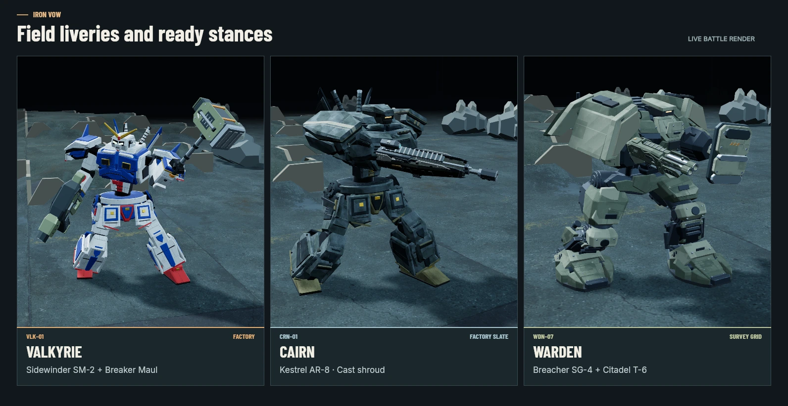

# Field finishes, combat stances and Cairn

Production-rendered desktop and narrow-viewport captures are in [the review panel](review.html). Factory and Survey show the same Workshop hull. The Cairn images show the refitted frame in Workshop and both mechs in the same sortie.

The focused browser gates ran against the public v108 release with full Chromium rendering. `qa/gate-field-liveries.cjs` checks the four finishes, saved-career reload and deployment, nine desktop equipment combinations, two 390px battlefield cases, finite transforms, a damaged-arm guard transition, and 320px paint overflow. `qa/gate-cairn.cjs` purchases and assigns Cairn and Valkyrie through Workshop, refits Cairn, checks four finishes, reloads the career, compares their generated geometry, and deploys both with Cairn's live rig and ready guard.

`summary.json` records the results, runtime hashes, and production file comparison. Tests used fixture credits and isolated browser storage. Browser checks covered desktop and emulated touch devices. Native mobile performance is unverified.

The damage check caught field finishes dropping out when armor scorched. Both patterned plates and textured GLB armor now retain their markings under the scorch layer. The Cairn purchase check also verifies that its stock Kestrel carries the cast shroud before refitting.

The public Rig Bench opens directly on [Cairn](https://iron-vow-mercenary-command.karmi-nguyen.chatgpt.site/?bench=rig&frame=21) or [Valkyrie](https://iron-vow-mercenary-command.karmi-nguyen.chatgpt.site/?bench=rig&frame=5).
