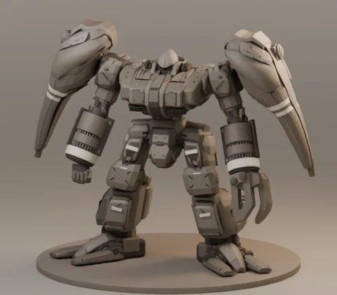

# Raven heavy assault hero

The Mech Bay lists Raven at 400,000 credits. Iron Pass also stocks it at the local port price. The rotary gauntlet and clamp are part of the chassis. The two shoulder shields share the health of their respective arms.

Both arms take 25% less damage after ordinary armor and Brace reduction, rounded to whole HP. When braced, Raven redirects frontal body and leg hits onto its working arms. A volley starts with the healthier shield and alternates between working shields. A single surviving arm covers the front alone. Side, rear, and cockpit hits keep their original locations.



Open `tools/authoring/raven/Raven-Rig.blend` to edit the six actions. The shield bones articulate independently from the upper arms. Rebuild the compressed battle asset from the repository root with Blender.

```sh
blender -b tools/authoring/raven/Raven-Rig.blend --python tools/export_raven_v2.py
```

Run `node qa/check-raven.cjs` to verify purchase, save, defensive arcs, damage, and both built-in attacks. Run `node qa/check-rig-v2.cjs dist/rig-bench/rig-v2/raven.glb` to verify the exported game asset. Use `?bench=rig&frame=30` to inspect the clips interactively.

Set `IRON_VOW_QA_SCENARIOS=checkRavenVisuals` when running `npm run test:browser` to exercise Raven in the battlefield, Mech Bay, Workshop and Rig Bench. [Browser capture of the deployed shields](rig-bench.webp).
